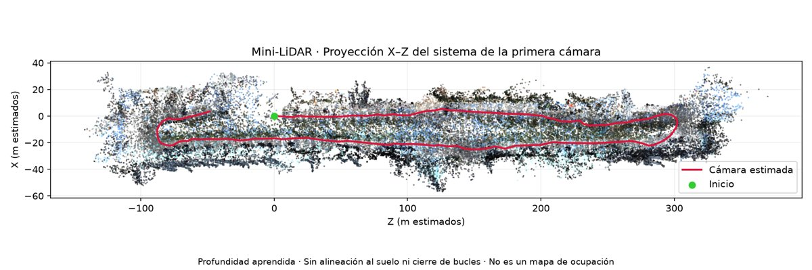

# MiniLiDAR

Reconstrucción monocular experimental: convierte un video en una nube de puntos coloreada, una trayectoria de cámara y una vista aérea. Utiliza ORB + PnP, Depth Anything V2 Metric Small y Open3D. El visor 3D funciona localmente en el navegador.

## Resultados

Ejemplo de la secuencia KITTI 06 distribuida con pySLAM. Son resultados reales del programa, no imágenes generadas.




La reconstrucción de ejemplo es parcial: 151 poses aceptadas hasta el fotograma 750. No representa precisión LiDAR.

## Instalación

Python 3.11 recomendado. Probado en macOS; la disponibilidad de Open3D depende de la plataforma y versión de Python.

```bash
python3 -m venv .venv
source .venv/bin/activate
pip install -r requirements.txt
mkdir -p vendor
git clone https://github.com/DepthAnything/Depth-Anything-V2.git vendor/depth-anything-v2
```

Los pesos métricos Small se descargan desde Hugging Face durante la primera ejecución. Después se pueden reutilizar desde la caché. También pueden colocarse en `modelos/`. El código y los pesos de terceros conservan sus propias licencias; no están incluidos en este repositorio.

## Uso

```bash
python ejecutar.py "/ruta/habitacion.mp4"
python ejecutar.py "/ruta/exterior.mp4" --exterior
python ejecutar.py "/ruta/habitacion.mp4" --calibracion "/ruta/camara.yaml"
python ejecutar.py --abrir-ultimo
```

En macOS también puedes usar `./mapear`. Ajusta resolución, intervalo entre fotogramas y densidad en `configuracion.json`. Sin calibración se usa un campo de visión aproximado: calibra la cámara para obtener mejores resultados.

## Archivos generados

Cada ejecución crea una carpeta independiente en `resultados/`:

| Archivo | Contenido |
| --- | --- |
| `mapa_3d.html` | Visor interactivo 3D y vista aérea |
| `nube_3d.ply` | Puntos 3D con color |
| `trayectoria.csv` | Poses estimadas por fotograma |
| `vista_superior.png` | Proyección X–Z |
| `resumen.json` | Configuración y resultado del seguimiento |
| `tracking.jsonl` | Diagnóstico por fotograma |

## Código

- `ejecutar.py`: entrada, validación de rutas y ejecución.
- `mini_lidar_orb_depth.py`: profundidad, ORB, PnP y reconstrucción.
- `visor_3d.py`: visor HTML sin servicios externos.
- `tests/`: pruebas geométricas sin descargar modelos.

```bash
python -m unittest discover -s tests -v
```

## Límites

La profundidad y escala son estimadas. No incluye IMU, cierre de bucles ni optimización global. Puede perder seguimiento, acumular deriva o exportar solo una parte del video. La vista aérea no es un mapa de ocupación ni se alinea automáticamente al suelo. No está diseñado para medición, navegación autónoma o decisiones de seguridad.

## Créditos

- [Depth Anything V2](https://github.com/DepthAnything/Depth-Anything-V2): estimación de profundidad.
- [OpenCV](https://opencv.org/): características ORB y PnP.
- [Open3D](https://www.open3d.org/): manejo de nubes.
- [KITTI](https://www.cvlibs.net/datasets/kitti/) y [pySLAM](https://github.com/luigifreda/pyslam): secuencia utilizada para los ejemplos. Las imágenes de resultados se incluyen para documentar esta prueba; los videos del dataset no se redistribuyen.
