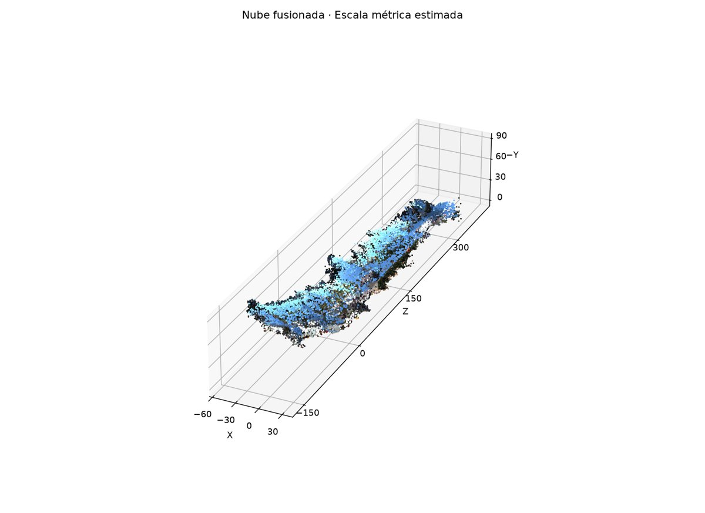

# MiniLiDAR

Experimental monocular reconstruction: turn a video into a colored point cloud, an estimated camera trajectory, and a top-down view. Built with ORB + PnP, Depth Anything V2 Metric Small, and Open3D. The interactive 3D viewer runs locally in your browser.

## Results

Example reconstruction from the KITTI 06 sequence distributed with pySLAM.




This example is a partial reconstruction: 151 accepted poses through frame 750. It does not provide LiDAR-level accuracy.

## Installation

Python 3.11 is recommended. Tested on macOS; Open3D availability depends on your platform and Python version.

```bash
python3 -m venv .venv
source .venv/bin/activate
pip install -r requirements.txt
mkdir -p vendor
git clone https://github.com/DepthAnything/Depth-Anything-V2.git vendor/depth-anything-v2
```

The Small metric depth weights are downloaded from Hugging Face on the first run and reused from the cache afterward. You can also place them in `modelos/`. Third-party code and model weights retain their respective licenses and are not bundled in this repository.

## Usage

```bash
python ejecutar.py "/path/to/room.mp4"
python ejecutar.py "/path/to/outdoor.mp4" --exterior
python ejecutar.py "/path/to/room.mp4" --calibracion "/path/to/camera.yaml"
python ejecutar.py --abrir-ultimo
```

Existing command names and flags are preserved for compatibility. `--exterior` selects the outdoor model, `--calibracion` supplies camera calibration, and `--abrir-ultimo` opens the latest result.

On macOS, you can also run `bash mapear "/path/to/video.mp4"`. Adjust resolution, frame stride, and point density in `configuracion.json`. Without calibration, the program uses an approximate field of view. Calibrate your camera for better results.

## Output files

Each run creates a separate folder under `resultados/`:

| File | Contents |
| --- | --- |
| `mapa_3d.html` | Interactive 3D viewer and top-down view |
| `nube_3d.ply` | Colored 3D point cloud |
| `trayectoria.csv` | Estimated camera poses by frame |
| `vista_superior.png` | X–Z projection |
| `resumen.json` | Configuration and tracking summary |
| `tracking.jsonl` | Per-frame tracking diagnostics |

## Project structure

- `ejecutar.py`: command-line entry point, path validation, and execution.
- `mini_lidar_orb_depth.py`: depth estimation, ORB features, PnP, and reconstruction.
- `visor_3d.py`: self-contained HTML viewer.
- `tests/`: geometry tests that do not require model downloads.

```bash
python -m unittest discover -s tests -v
```

## Limitations

Depth and scale are estimated. There is no IMU integration, loop closure, or global optimization. Tracking can fail, drift can accumulate, and a run may reconstruct only part of a video. The top-down view is not an occupancy map and is not automatically aligned with the floor. This project is not intended for measurement, autonomous navigation, or safety-critical decisions.

## Credits

- [Depth Anything V2](https://github.com/DepthAnything/Depth-Anything-V2): depth estimation.
- [OpenCV](https://opencv.org/): ORB features and PnP.
- [Open3D](https://www.open3d.org/): point-cloud processing.
- [KITTI](https://www.cvlibs.net/datasets/kitti/) and [pySLAM](https://github.com/luigifreda/pyslam): example sequence. Result images document this experiment; dataset videos are not redistributed.
